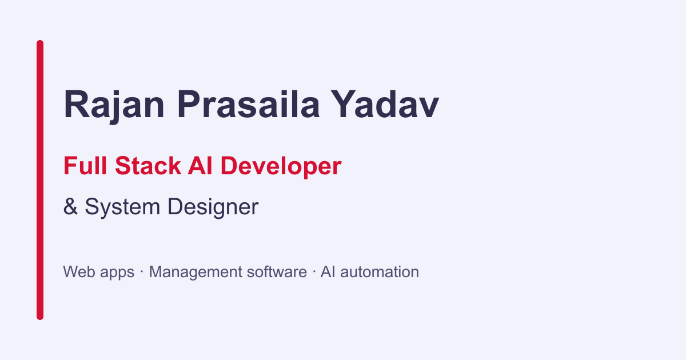

# Rajan Prasaila Yadav - Full Stack AI Portfolio



A high-performance, production-ready portfolio website built with the latest web technologies: **Next.js 16, React 19, Tailwind CSS v4, and Framer Motion**.

**Live Demo:** [https://rajan-portfolio-iota.vercel.app/](https://rajan-portfolio-iota.vercel.app/)  
**GitHub Repo:** [https://github.com/Rajan7013](https://github.com/Rajan7013)

---

## 🚀 Tech Stack

This project uses a cutting-edge stack optimized for speed, SEO, and scalability.

### Core Framework
- **[Next.js 16 (App Router)](https://nextjs.org/)**: The latest version of the React framework with Server Components and TurboPack.
- **[React 19](https://react.dev/)**: Leveraging the newest React features for concurrent rendering.
- **[TypeScript](https://www.typescriptlang.org/)**: Fully typed codebase for robustness.

### Styling & Animation
- **[Tailwind CSS v4](https://tailwindcss.com/)**: Zero-runtime utility-first CSS framework.
- **[Framer Motion](https://www.framer.com/motion/)**: Complex animations for page transitions and scroll effects.
- **[Lucide React](https://lucide.dev/)**: Beautiful, consistent SVG icons.
- **[Radix UI](https://www.radix-ui.com/)**: Accessible primitive components for dialogs and slots.

### Features & Tools
- **[Vercel Analytics](https://vercel.com/analytics)**: Privacy-friendly real-time visitor tracking.
- **[PWA (Progressive Web App)](https://github.com/shadowwalker/next-pwa)**: Installable on mobile and desktop devices.
- **[Recharts](https://recharts.org/)**: Data visualization for dashboard components.
- **[SEO Optimized]**: Custom metadata, Open Graph tags, JSON-LD structured data, and sitemap generation.

---

## 📂 Project Structure

```bash
portfolio-project/
├── app/                  # Next.js App Router Pages & Layouts
│   ├── about/            # About Page
│   ├── certificate/      # Certificates Gallery
│   ├── contact/          # Contact Form (Google Sheets integrated)
│   ├── projects/         # Portfolio Projects Showcase
│   ├── services/         # Services Offered
│   ├── stack/            # Tech Stack & Architecture View
│   ├── layout.tsx        # Root Layout (Navbar, Analytics, SEO)
│   ├── page.tsx          # Home Page
│   └── robots.ts         # SEO Robots file
├── components/           # Reusable React Components
│   ├── analytics/        # Custom Tracking Components
│   ├── ui/               # Generic UI Elements (Buttons, Cards)
│   ├── Navbar.tsx        # Responsive Navigation
│   ├── Footer.tsx        # Site Footer
│   └── InstallPWA.tsx    # PWA Install Prompt
├── public/               # Static Assets
│   ├── image/            # Profile & Project Images
│   └── technology logo/  # Tech Stack SVGs
├── styles/               # Global Styles
└── next.config.ts        # Next.js Configuration
```

---

## 🛠️ Getting Started

### Prerequisites
Make sure you have **Node.js 18+** installed.

### 1. Clone the repository
```bash
git clone https://github.com/Rajan7013/portfolio-project.git
cd portfolio-project
```

### 2. Install dependencies
```bash
npm install
# or
yarn install
# or
pnpm install
```

### 3. Run the development server
```bash
npm run dev
```
Open [http://localhost:3000](http://localhost:3000) with your browser to see the result.

### 4. Build for Production
```bash
npm run build
npm start
```

---

## 🚢 Deployment

The easiest way to deploy your Next.js app is to use the [Vercel Platform](https://vercel.com/new).

### Manual Update Checklist
Since this project is connected to a Git repository, push your changes to update the live site:

1.  **Stage Changes**:
    ```bash
    git add .
    ```
2.  **Commit**:
    ```bash
    git commit -m "Update portfolio features"
    ```
3.  **Deploy**:
    ```bash
    git push
    ```
    *Vercel will automatically detect the push and redeploy your site.*

---

## 📝 SEO & Analytics Status

- **Sitemap**: `/sitemap.xml` is auto-generated.
- **Robots.txt**: configured to allow all major bots.
- **Analytics**: Vercel Analytics is active and tracking page views.

---

## 👤 Author

**Rajan Prasaila Yadav**  
Full Stack AI Developer & System Designer

- **Portfolio**: [rajan-portfolio-iota.vercel.app](https://rajan-portfolio-iota.vercel.app/)
- **GitHub**: [@Rajan7013](https://github.com/Rajan7013)
- **Email**: rajanprasaila@gmail.com

---

## ✅ Post-Deployment Checklist

- [ ] **Push Changes**: Run the Git commands (`git add .`, `git commit`, `git push`) to update the live site.
- [ ] **Verify Live**: Check `https://rajan-portfolio-iota.vercel.app/` to ensure the new build works.
- [ ] **Social Share**: Share your new portfolio URL on LinkedIn & Twitter immediately.
- [ ] **Future Growth**: Consider adding a "Blog/Articles" section to drive organic search traffic from AI engines.
